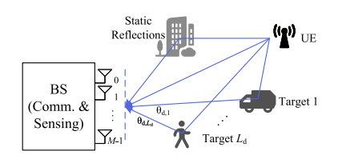
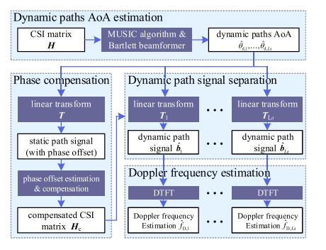
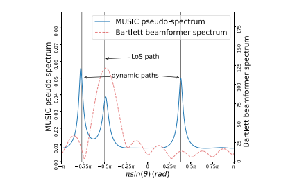
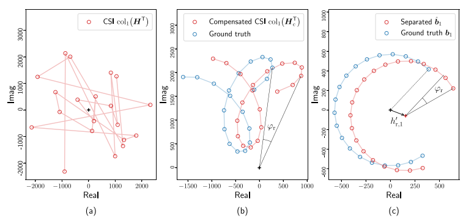
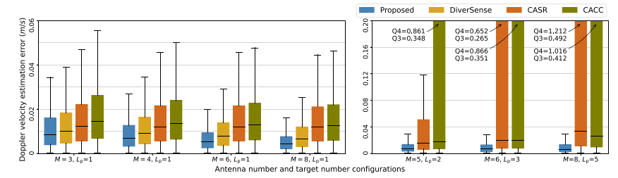
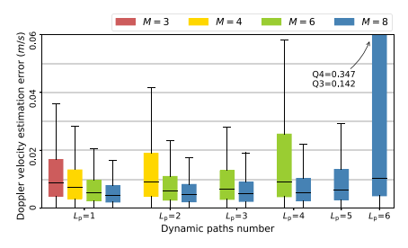
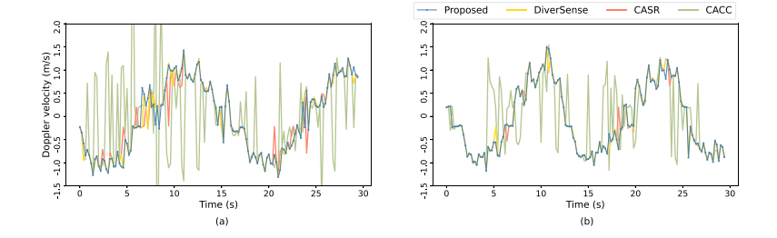

# Breakthrough in Clock Asynchronous Bottleneck! ISAC System's New Scheme for Multi-Target Doppler Frequency Estimation Coming Soon [with Python code attached]

Personal Blog: https://www.cnblogs.com/EWFrontier  
✿Breaking Through the Asynchronous Clock Bottleneck in ISAC Systems! New Scheme for Multi-Target Doppler Frequency Estimation in ISAC ✿1. Article Title: Doppler Frequency Estimation in ISAC Systems with Asynchronous Clocking Between Transmitter and Receiver  
2. Abstract: In Integrated Sensing and Communications (ISAC) systems where transmitters and receivers have asynchronous clocks, multi-target Doppler frequency estimation is a challenging problem. Existing technologies have numerous limitations and often fail to effectively handle multi-target scenarios. This paper proposes an array-based multi-target Doppler frequency estimation scheme: firstly, a new arrival angle (AoA) estimation algorithm is designed, then using the estimated AoA to construct orthogonal projections, separating static paths from various dynamic paths, thereby completing the compensation for the asynchronous clock and Doppler frequency estimation. Simulation and experimental results show that the proposed scheme is effective in multi-target scenarios and outperforms some existing advanced methods in single-target scenarios.  
Keywords: Integrated Sensing and Communications; Doppler Frequency Estimation; Passive Sensing; Asynchronous Clocking  
3. Introduction: Integrated Sensing and Communications (ISAC) technology, centered on communication, leverages signal and hardware modules of communication systems such as Wi-Fi, LoRa, LTE to achieve sensing functions, significantly reducing hardware costs and frequency resources. Doppler frequency estimation is a fundamental component of many centralized ISAC applications, including target detection and tracking in vehicle networks, activity recognition, and biomedical signal extraction.  
Double-base station passive sensing is one of the typical configurations in centralized ISAC systems (as shown in Figure 1). In this configuration, the receiver uses the spatially separated signals from the transmitter (usually channel state information reference signal, CSI) for sensing, while the oscillators of the transmitter and receiver are not synchronized. Asynchronous clocking can lead to timing offset (TO), carrier frequency offset (CFO), which in turn causes phase shift due to time-varying CSI measurement, hindering coherent processing of non-continuous CSI measurements and causing perception blur in Doppler and delay estimation.
Existing Doppler velocity estimation schemes for clock-synchronous scenarios typically employ cross-antenna mutual correlation (CACC) or cross-antenna signal ratio (CASR) methods to eliminate TO and CFO, thereby achieving accurate Doppler velocity estimation. These methods essentially perform nonlinear transformations on dynamic path signals by computing the conjugate multiplication or ratio of received signals from adjacent antennas. When handling superimposed perceptual signals, it leads to mutual modulation and interference between different dynamic path signals, making it challenging to separate multiple target signals.
This paper proposes a scheme for estimating multiple dynamic targets' Doppler velocities using array signal estimation in clock-asynchrony situations. Unlike existing schemes, this approach aims to estimate and compensate for the phase offset associated with CSI measurements, and achieves path separation when the arrival angles (AoAs) of each path are not closely aligned. The scheme first estimates the arrival angles of each dynamic path, constructs orthogonal projections based on these angles, and separates static path signals from each dynamic path signal; then, it uses the separated static path signals to estimate and compensate for the phase offset caused by TO and CFO; finally, it estimates the corresponding Doppler velocities of each dynamic path signal. Compared to existing schemes, the proposed method has two major advantages: 1) it retains the linear characteristics of multipath signals in clock-asynchrony compensation; 2) it achieves complete separation of each dynamic path signal. Therefore, this scheme can be compatible with traditional perception algorithms based on linear signal processing, enabling accurate multi-target Doppler frequency estimation, and its effectiveness has been verified through simulations and experimental results.
The core idea of the proposed Doppler frequency estimation scheme is to compensate for the phase offsetφ caused by TO and CFO, without introducing nonlinear distortion, and to completely separate the CSI of each dynamic path from other paths. The specific steps are as follows:
1. Dynamic Path AoA Estimation (AoA)
2. Phase compensation constructs a steering matrix based on the estimated dynamic AoA, and obtains a linear transformation matrix T through singular value decomposition (SVD). This matrix possesses orthogonal or semi-orthogonal properties with the dynamic path, projecting signals onto the null space of the dynamic path to suppress it, and extracting signals from the combined static paths. The optimal weight vector is designed to maximize the signal-to-noise ratio of phase offset estimation. The weight vector is obtained through feature value decomposition, which in turn estimates the phase offset and compensates for the CSI matrix. The residual phase offset remains constant over time, thus not affecting Doppler frequency estimation.
3. Dynamic Path Signal Separation: For each dynamic path, construct a steering matrix that includes the other dynamic path's steering vectors. Obtain the corresponding transformation matrix through SVD. Project the compensated CSI signals onto this matrix's null space to preserve the target dynamic path and suppress others. Merge the projected signals, eliminating static path projection effects by subtracting the DC component, resulting in separated dynamic path signals (where the DC residuals approach zero with increasing number of snapshots).
4. Doppler frequency estimation utilizes the Discrete Time Fourier Transform (DTFT) of separated dynamic path signals to estimate the Doppler frequency. The continuity in the frequency domain of the DTFT avoids the sampling interval issue of the traditional Discrete Fourier Transform (DFT), and the highest peak in the DTFT spectrum is used as the Doppler frequency estimation value. This scheme is suitable for scenarios where the absolute value of the Doppler frequency is not less than 1/(2KΔt), where K represents the number of snapshots, and Δt is the time interval between snapshots.
V. Conclusion This paper proposes a multi-target Doppler frequency estimation scheme for an ISAC system with clock asynchronous transmitters and receivers, which can also obtain arrival angle (AoA) estimates for both the transmitter and the reflected target. Both simulation and experimental results have verified the effectiveness of this scheme, providing a new approach for multi-target passive ISAC perception. By extending to multiple subcarriers, this scheme is expected to be applied to ultra-Doppler perception scenarios such as ranging and positioning.
★

## Images

<!-- PAYMENT_BLOCK -->

## Get this dataset

- Payment link (Stripe): [Buy now](https://buy.stripe.com/3cs8yP7sY87d0vu9AB)
- Payment QR code: 

<!-- /PAYMENT_BLOCK -->
